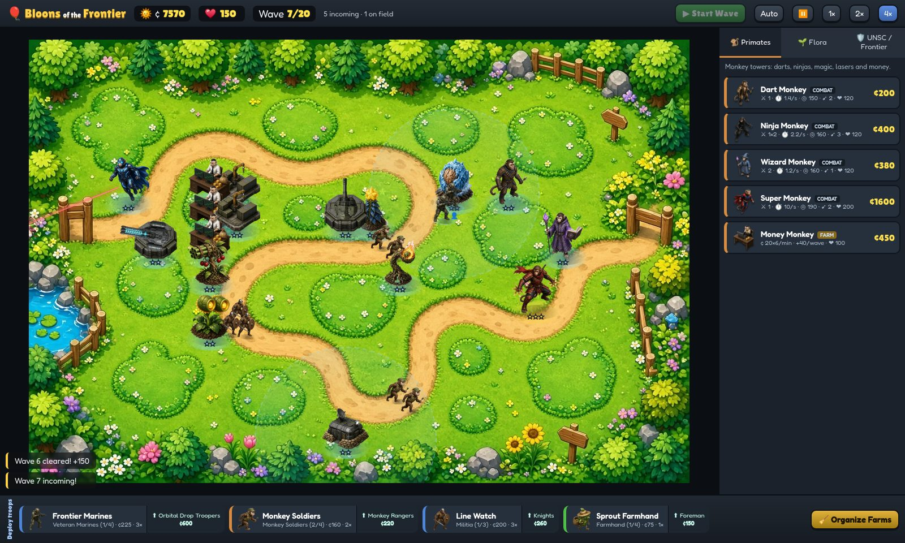
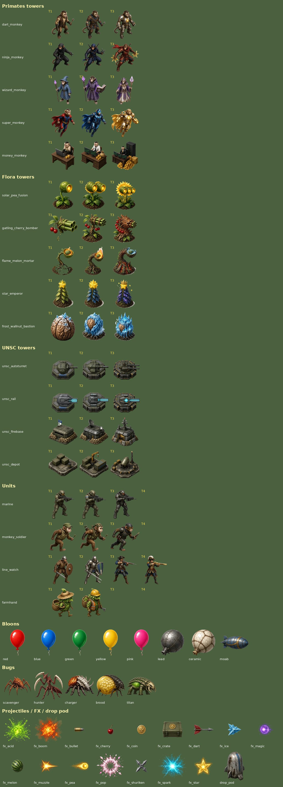
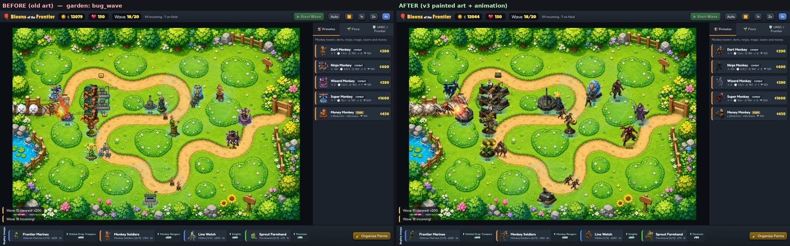

# Bloons of the Frontier (v2, browser)

**▶ Play:** https://beeforestry.github.io/bloons-of-the-frontier/



Tower defense + light RTS in the browser. Three factions (Primates, Flora, UNSC/Frontier) hold the line against
layered bloons and an original bug hive. You build towers, deploy Halo-Wars-style troop squads, buff them with Cover
towers, farm Credits, and use a Farmhand worker to **Organize Farms** into a tight block.

**Stack:** Vite 5, TypeScript (strict), plain Canvas 2D for the map, DOM/CSS for the UI. There is no runtime dependency.
`npm run build` writes a static `dist/` that works from any path (`base: './'`), so it can be dropped into any static host. Serve it over http(s), e.g. `npx serve dist` or `python3 -m http.server -d dist`. For a double-click build, `npm run single` packs everything (JS, CSS, art, fonts) into one self-contained HTML that runs from `file://`.
GitHub Pages: the live site is served from the `gh-pages` branch (a `BASE=/bloons-of-the-frontier/ npm run build` of `dist/`). An Actions workflow that does this on every push is ready in `docs/pages-workflow.yml`: move it to `.github/workflows/` to switch Pages to "GitHub Actions" (pushing workflow files needs a token with the `workflow` scope).

## Run
```bash
npm install
npm run dev            # http://localhost:5173  (?map=morro|tropical skips the menu)
npm run build          # typecheck + upgrade-rule validation + static build -> dist/
npm run preview        # serve dist/
npm run test:e2e       # headless Playwright playtest (screenshots -> screenshots/)
npx tsx scripts/validate-selftest.ts   # proves the validator catches a bad upgrade
```

## Controls
- **Towers:** click a faction tab, click a card, then click a highlighted cell. Shift keeps placing. Esc or right-click cancels.
- **Selected tower:** click a tower to open its panel: **Upgrade** (shows stat deltas), **Sell** (70% refund),
  **Target** (First / Last / Strong / Close) and **Eject troops** on Cover towers. Hotkeys: U, S, T.
- **Troops:** click a squad in the bottom bar, then click the map. A drop pod lands there and that spot is the squad's rally point.
  Click a squad to select it, then click or right-click the map to move its rally point. Use **Garrison** to walk the squad into the nearest Cover tower.
  **⬆ Research** upgrades every squad of that type.
- **Organize Farms** (button or O): a Sprout Farmhand walks to your farms and slides them into a tight grid.
- **Pickups:** farms and some bugs drop credit crates. Farmhands collect them at 100%. A click also collects at 100%.
  Crates left alone auto-collect at 60% after 14 s.
- **Waves:** Space or ▶ starts the next wave. Auto starts each wave by itself. Speed can be set to 1×, 2× or 4×, and ⏸ pauses.

See `docs/DESIGN.md` for the architecture.

## Element combos (t103)
Some towers stamp an element status on what they hit; a second, different status on the same enemy triggers a combo.
Open **⚗ Element combos** on the main menu, or **⚗ ?** in a selected tower's panel, for the in-game guide (English + Spanish).

| Status | Towers (tier that unlocks it) |
|---|---|
| 💧 Soaked | Tidebreaker Destroyer (all), Corrosive Glue Slinger (tier 2+) |
| 🔥 Burning (damage over time) | Flame Melon Mortar (all), Bulwark Battle Tank (tier 3, incendiary shells) |
| ❄ Chilled | Frost Oakshield Bastion (all) |
| ⚡ Shocked | Tesla Coil (all), Harbor Beacon (tier 2+), Rail Lance Emplacement (tier 2+) |

| Combo | Recipe | Effect |
|---|---|---|
| Conduct | 💧 + ⚡ | chain lightning to up to 4 enemies within 120 px (50% of the hit + 4 each) |
| Freeze | 💧 + ❄ | frozen solid 1.4 s (heavies ×0.6, bosses ×0.3), then 5 s immunity |
| Shatter | ❄ + heavy hit | +60% on that hit (+100% and the ice breaks if frozen). Heavy = explosive, rail, Marksman, tank, Snapjaw, obelisk |
| Steam | 🔥 + 💧 | fire goes out; 3 s of armor plating offline and +20% damage taken (+10% on bosses) |
| Wildfire | 🔥 + explosion | burn spreads to up to 5 enemies within 80 px |

🔥 and ❄ cancel each other out. All the tuning is in `src/systems/Elements.ts` (`ELEM_TUNE`).
The idea comes from **[Lightkeepers](https://github.com/vega-star/lightkeepers)** by vega-star (Apache-2.0), a tower-defense tech demo built around combining elements.
No code or art was taken from it; this is our own implementation.

## Tower fusion + predictive aiming (t104)
**Fusion.** Build two towers of the same type, take both to their last tier, and put them side by side (their footprints
touching, up to 40 px apart). Select either one: the panel shows **⚛ Fuse with neighbour** with the fee and the stat
changes, and a dashed gold line marks the partner. Fusing merges the partner into the selected tower and frees its spot.
- Fused tower: ×1.4 damage, +10% fire rate, +8% range, +1 pierce/chain, ×1.2 splash, ×1.8 HP, and every other stat at least
  as good (support auras, farm income ×2.1, slows capped at 75%). Visual level +1, model 15% bigger, gold glow.
- Overall about 2× one max tower (the pair's power in one spot). Fee: 40% of one tower's full price (e.g. Dart Scout ¢390,
  Apex Laser Scout ¢2,685). Sell value stays 70% of everything
  invested (both towers + fee).
- Look: gold aura with counter-rotating rings, orbiting sparks and a ★ medallion in 2D; gold halo rings, a light column and
  a ★ badge over the model in first person; the name gets "★ Fused".
- Same owner only (co-op), not path objects or single-use pods, a fused tower can't fuse again. Save/Continue and co-op
  sync keep the fused state. Data: `src/data/fusion.ts`; the validator checks that every fused tier is strictly stronger.

**Predictive aiming.** Towers with finite-speed projectiles now lead their target: `Enemy.predict(t)` walks the enemy
along its lane at its current speed (slow and surge timers included, stunned/blocked/leaping enemies stay put), and the
shot is aimed at the intercept point (4 time-of-flight iterations). Lobbed shots (Melon, Glue vial/canister) land on the
predicted point. Troop rifles lead too. Hitscan and beam weapons, boomerangs and fixed-lane guns are unchanged. In first
person, a shot with the crosshair on an enemy leads it; a free crosshair shot goes exactly where you aim.
Hit rate of the aimed (centre) shot in the `tests/aim_sim.py` sim: El Morro 90.9% → 94.4%, Isla de Cabras 83.1% → 90.5%.

## Tier-3 specializations, hidden fusions, neighbour effects (t105)
**Specializations.** 16 towers pick one of two permanent branches when they buy their last tier (the panel shows two
buttons with the stat changes; the U hotkey won't pick for you). Every branch is strictly stronger than tier 2 and at
least as strong as the old plain tier 3 (about +6% to +40% power; element branches trade raw power for a status).
Branches get a coloured ground ring plus a shield emblem with their initials in 2D, and a coloured halo plus the same
emblem over the model in first person.

| Tower | Branch A | Branch B |
|---|---|---|
| Dart Scout | Longshot Marksman (×1.25 dmg, +8% range) | Rapid Volley (+33% rate) |
| Shadow Scout | Frost Kunai (❄ Chilled, +25% slow) | Shadow Blade (×1.3 dmg) |
| Arcane Scout | Stormcaller (⚡ Shocked) | Pyromancer (🔥 Burning, ×1.25 splash) |
| Apex Laser Scout | Plasma Lance (×1.3 dmg) | Hyper Beam (+30% rate) |
| Marksman Scout | Deadeye (×1.35 dmg) | Suppressor (+30% rate, slow) |
| Glaive Scout | Razor Arc | Twin Glaives |
| Solar Pea Fusion | Sunburst (stronger sun aura) | Gatling Pods |
| Gatling Cherry Bomber | Firestorm (🔥) | Overclock |
| Flame Melon Mortar | Napalm Melons (longer burn) | Siege Melons |
| Tesla Coil | Arc Web (+2 chain) | Overcharge |
| Autoturret / Flak / Tank / Destroyer | Hailstorm / Skyshredder / Siege Breaker / Tidal Barrage | AP Rounds / Flak Barrage / Hunter Killer / Broadside |
| Corrosive Glue Slinger | Corrosive Vat | Tar Pit |
| Frost Oakshield Bastion | Glacier Keep (cover) | Permafrost (ice shots) |

Fusion rule: two specialised towers fuse only if they took the same branch. A specialised pair's fusion multipliers are
halved, so the fused result is still about 2× one max tower. Data: `src/data/specs.ts`. The validator checks both branches
against tier 2 (no stat down, power up, looks up) and checks every fused branch.

**Hidden fusions.** Two different max-tier towers of the same owner, side by side, can react into a tower that is never sold
in the shop. The panel shows **⚛ Fuse with … → ???** (and a violet link line) until you have made it once on this browser
(`localStorage` `bof.recipes`); after that it shows the name. The ⚗ guide has an almanac with hints and discovered entries.

| Recipe | Result |
|---|---|
| Tesla Coil + Frost Oakshield Bastion | **Storm Core**: chain lightning ×1.35 dmg, +3 jumps, alternating ⚡ Shock / ❄ Chill, slow, keeps the Bastion cover aura |
| Flame Melon Mortar + Dart Scout or Solar Pea Fusion | **Inferno Battery**: 3-melon burning volleys, +35% rate (Burning + explosion → Wildfire) |
| Firebase Bunker + Sunflower | **Elite Barracks**: +2 garrison slots, ×1.4 aura HP, troops take −80% damage, plus a sun aura |

Cost: both towers + a fee of 30% of their average full price; sell value 70% of everything. Recipe towers can't upgrade or
fuse again. Data: `src/data/recipes.ts`; the validator checks they stay hidden and beat every parent (incl. branches) by >10%.

**Neighbour effects.** A combat tower right next to (bases within 70 px) an ❄ ice tower adds Chilled (1 s) on every 3rd hit,
next to a 🔥 fire tower adds Burning, and next to a support tower gets +6% attack speed (its own stack). Only the nearest
elemental neighbour counts, never its own element. This feeds the normal element system, so neighbours can set up combos
(a Soaking Glue Slinger beside a Frost Bastion freezes enemies). Faint animated link lines show the links (brighter when
selected), and the tower panel lists "Neighbour effects". Tuning: `PROX` in `src/systems/Proximity.ts`.

## Art (v3)
All sprites are one painterly, realistic 3/4-view set (`public/assets/v3`, WebP, ~1.2 MB). Each tower and troop tier has its own sprite, and every tier is
visibly more advanced. Turrets use a separate rotating head with barrel recoil, and units, bugs and bloons are animated with walk/scuttle/bob motion and painted pop/death/muzzle FX.
The pipeline is in `art_src/tools` (cutout → split → WebP + `src/render/art.manifest.json`). The large raw sheets and cutouts are git-ignored.



