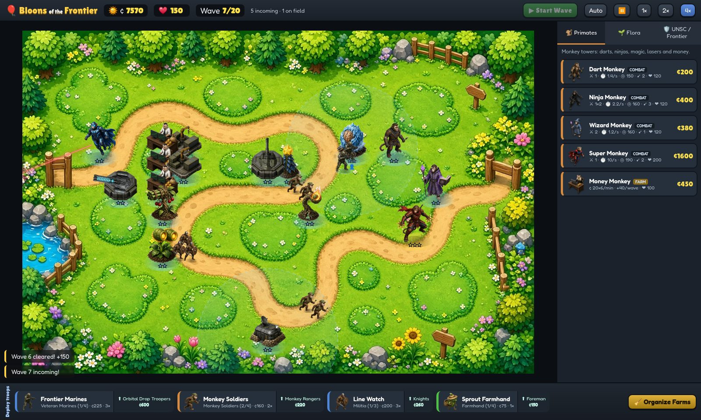
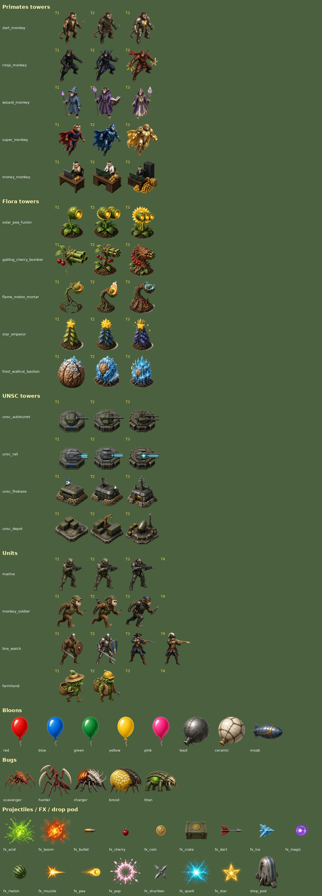
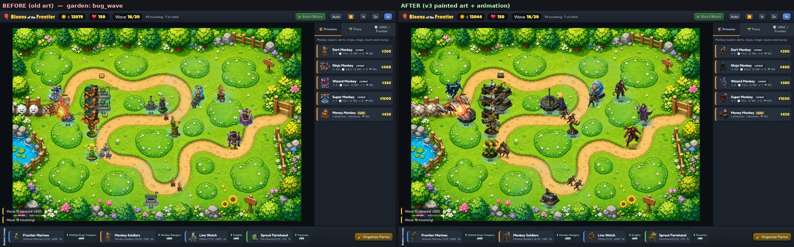

# Bloons of the Frontier (v2, browser)

**▶ Play:** https://beeforestry.github.io/bloons-of-the-frontier/



Tower defense + light RTS in the browser. Three factions (Primates, Flora, UNSC/Frontier) hold the line against
layered bloons and an original bug hive. You build towers, deploy Halo-Wars-style troop squads, buff them with Cover
towers, farm Credits, and use a Farmhand worker to **Organize Farms** into a tight block.

**Stack:** Vite 5, TypeScript (strict), plain Canvas 2D for the map, DOM/CSS for the UI. There is no runtime dependency.
`npm run build` writes a static `dist/` that works from any path (`base: './'`), so it can be dropped into any static host. Serve it over http(s), e.g. `npx serve dist` or `python3 -m http.server -d dist`. For a double-click build, `npm run single` packs everything (JS, CSS, art, fonts) into one self-contained HTML that runs from `file://`.
GitHub Pages: the live site is served from the `gh-pages` branch (a `BASE=/bloons-of-the-frontier/ npm run build` of `dist/`). An Actions workflow that does this on every push is ready in `docs/pages-workflow.yml`: move it to `.github/workflows/` to switch Pages to "GitHub Actions" (pushing workflow files needs a token with the `workflow` scope).

## Run
```bash
npm install
npm run dev            # http://localhost:5173  (?map=garden|jungle skips the menu)
npm run build          # typecheck + upgrade-rule validation + static build -> dist/
npm run preview        # serve dist/
npm run test:e2e       # headless Playwright playtest (screenshots -> screenshots/)
npx tsx scripts/validate-selftest.ts   # proves the validator catches a bad upgrade
```

## Controls
- **Towers:** click a faction tab, click a card, then click a highlighted cell. Shift keeps placing. Esc or right-click cancels.
- **Selected tower:** click a tower to open its panel: **Upgrade** (shows stat deltas), **Sell** (70% refund),
  **Target** (First / Last / Strong / Close) and **Eject troops** on Cover towers. Hotkeys: U, S, T.
- **Troops:** click a squad in the bottom bar, then click the map. A drop pod lands there and that spot is the squad's rally point.
  Click a squad to select it, then click or right-click the map to move its rally point. Use **Garrison** to walk the squad into the nearest Cover tower.
  **⬆ Research** upgrades every squad of that type.
- **Organize Farms** (button or O): a Sprout Farmhand walks to your farms and slides them into a tight grid.
- **Pickups:** farms and some bugs drop credit crates. Farmhands collect them at 100%. A click also collects at 100%.
  Crates left alone auto-collect at 60% after 14 s.
- **Waves:** Space or ▶ starts the next wave. Auto starts each wave by itself. Speed can be set to 1×, 2× or 4×, and ⏸ pauses.

See `docs/DESIGN.md` for the architecture.

## Art (v3)
All sprites are one painterly, realistic 3/4-view set (`public/assets/v3`, WebP, ~1.2 MB). Each tower and troop tier has its own sprite, and every tier is
visibly more advanced. Turrets use a separate rotating head with barrel recoil, and units, bugs and bloons are animated with walk/scuttle/bob motion and painted pop/death/muzzle FX.
The pipeline is in `art_src/tools` (cutout → split → WebP + `src/render/art.manifest.json`). The large raw sheets and cutouts are git-ignored.



